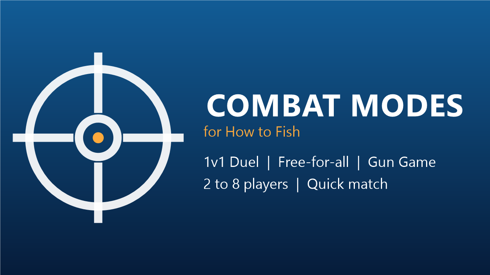

# How to Fish — Combat Modes



A multiplayer mod for **How to Fish** that turns its islands into arenas. It adds three competitive game modes, a native-looking menu, and a scoreboard, all playable with friends or through quick matchmaking.

| Mode | Players | Goal |
|---|---|---|
| **1v1 Duel** | 2 | First to win 5 rounds. Every round uses a random weapon kit, random attachments and a different island. |
| **Free-for-all** | 2–8 | First to 20 kills, or the best score after 10 minutes. Everyone shares the same kit, which changes every 2 minutes. |
| **Gun Game** | 2–8 | Every kill gives you the next weapon: sniper → assault rifle → SMG → shotgun → bow → pistol → knife. The first knife kill on the last level wins. Getting knifed sends you back one level. |

## Features

- **Native interface**: menus, lobby, HUD, scoreboard and end screen are built from the game's own UI elements, so they look and sound like the rest of the game.
- **Fair loadouts**: in every round all players receive the same weapons and the same randomly rolled attachments (sights, barrels, ammo upgrades, extended magazines, lasers, sharpness).
- **Matchmaking**: *Invite friends* opens the Steam overlay; *Quick match* finds an open lobby of the same mode or creates one, and merges players who search at the same time.
- **Host-authoritative**: the host runs the rules, tracks kills, respawns players and keeps everyone in sync.
- **Clean combat rules**: no saving, no server settings, no game respawn or revive during matches; the journal (Tab) is replaced by a hold-to-show scoreboard.
- **English and French**: texts follow the language selected in the game.
- **Safe for your saves**: matches run on a hidden temporary save that is deleted when the host leaves.

## Installation

1. Download the latest `HowToFish-CombatModes-<version>.zip` from the [Releases](../../releases) page.
2. In Steam, right-click **How to Fish** → **Manage** → **Browse local files**.
3. Extract the **whole** archive into that folder, next to `How to Fish.exe`, and accept to replace files if asked.
4. Start the game: a **Combat Modes** button appears in the main menu.

The archive already contains [BepInEx 5](https://github.com/BepInEx/BepInEx) (x64), the mod loader. If you already use BepInEx, you only need the `BepInEx/plugins/HowToFish.CombatModes` folder.

**Every player needs the mod, in the same version.** Players without it are removed from the lobby after a few seconds.

To uninstall, delete `BepInEx/plugins/HowToFish.CombatModes` (or `winhttp.dll` to disable every BepInEx mod).

## How to play

1. Main menu → **Combat Modes** → choose a mode.
2. **Invite friends** creates a private lobby and opens the Steam invite overlay. **Quick match** joins or creates a public lobby of that mode.
3. In Free-for-all and Gun Game, the host clicks **Start** once at least two players are in the lobby. Players can also join a game in progress.
4. Hold **Tab** during a match to see the scoreboard. **Esc** opens the game's pause menu.
5. At the end, the host can **Play again** (a duel offers **Rematch** to both players) or everyone can **Quit**.

## Configuration

Settings live in `BepInEx/config/htf.combatmodes.cfg`, created on first launch. The host's settings apply to the whole lobby.

| Section | Key | Default | Description |
|---|---|---|---|
| Match | `RoundsToWin` | `5` | Duel: rounds needed to win (1–15) |
| Match | `RoundTimeSeconds` | `90` | Duel: maximum round length; when time runs out, the player with more health wins (15–600) |
| Match | `CountdownSeconds` | `3` | Countdown before each round or match (0–10) |
| Match | `Kits` | `pistol+knife;shotgun+knife;smg+knife;assaultrifle+knife;sniperrifle+pistol;bow+knife;knife` | Weapon kits for the duel and free-for-all: kits separated by `;`, items by `+` |
| Match | `RandomUpgrades` | `true` | Roll random attachments for each round, identical for every player |
| Arena | `ArenaRadius` | `60` | Size of the fighting area in meters (10–500) |
| Arena | `IslandIndex` | `0` | Island used when rotation is disabled (main islands are 0–5) |
| Arena | `IslandRotation` | `true` | Use a different island for every duel round and every arena match |
| Arena | `SpawnA` / `SpawnB` | *(empty)* | Optional fixed duel spawns as `x,y,z` on `IslandIndex` |
| Arena | `KillTarget` | `20` | Free-for-all: kills needed to win (1–100) |
| Arena | `TimeLimitSeconds` | `600` | Free-for-all: match length (60–3600) |
| Arena | `KitRotationSeconds` | `120` | Free-for-all: time between kit changes (30–600) |
| Arena | `RespawnSeconds` | `3` | Respawn delay (0–15) |
| Arena | `SpawnProtectionSeconds` | `2` | Invulnerability after respawning, cancelled when you hit someone (0–10) |
| Arena | `Ladder` | `sniperrifle;assaultrifle;smg;shotgun;bow;pistol;knife` | Gun Game weapon order; at least 2 levels and the last one must be `knife` |
| Debug | `DebugSolo` | `false` | Test alone: the match starts without an opponent; F10 simulates a kill, F11 adds a bot to arena lobbies |
| Debug | `DebugPositionKey` | `F9` | Key that shows your position (useful to pick spawns) |
| Debug | `ForceImguiFallback` | `false` | Use the basic fallback interface instead of the native one |

Available weapon names: `pistol`, `shotgun`, `smg`, `assaultrifle`, `sniperrifle`, `bow`, `knife`, `brassknuckles`, `dynamite`.

## Compatibility

- Built and tested with How to Fish **1.1.3** and BepInEx **5.4.23**.
- On startup the mod checks every game method and field it relies on. If a game update changes one of them, the mode buttons are disabled and the BepInEx log (`BepInEx/LogOutput.log`) lists what is missing, instead of breaking your game.
- Lobbies only match players running the same game version and the same mod version.

## Building from source

Requirements: the .NET 8 SDK and a local installation of How to Fish with BepInEx 5.

```bash
dotnet build HowToFish.CombatModes.slnx -c Release -p:GameDir="C:\Path\To\How to Fish"
dotnet test HowToFish.CombatModes.slnx -c Release
```

`GameDir` is the folder that contains `How to Fish.exe`. The build references the game assemblies from that folder (nothing from the game is stored in this repository) and copies the plugin into `BepInEx/plugins/HowToFish.CombatModes`. `scripts/package.ps1` builds the release archive and `scripts/package-thunderstore.ps1` the Thunderstore package.

### Project layout

| Path | Content |
|---|---|
| `src/HowToFish.CombatModes.Core` | Game-independent logic: match rules, network codecs, settings, texts. Fully unit tested. |
| `src/HowToFish.CombatModes` | The BepInEx plugin: Harmony patches, host logic, Steam lobbies, native UI. |
| `tests/HowToFish.CombatModes.Tests` | xUnit tests for the core library. |
| `docs/GAME_INTERNALS.md` | Notes about the game internals the mod relies on. |
| `thunderstore/`, `art/` | Thunderstore manifest and README, icon and banner (`scripts/make-art.ps1`). |

## Contributing

Issues and pull requests are welcome. Please keep the core library free of Unity and game references, and cover rule changes with tests.

## Disclaimer

This is an unofficial fan-made mod. It is not affiliated with or endorsed by the developers of How to Fish. It does not contain any game files.

## License

[MIT](LICENSE)
